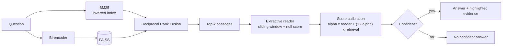

# Google Natural Questions: End-to-End Question Answering

[](https://github.com/YOUR-USERNAME/google-nq-end-to-end-qa/actions/workflows/ci.yml)


[](https://github.com/astral-sh/ruff)

Open-domain question answering over the Wikipedia passages of Google's
[Natural Questions](https://ai.google.com/research/NaturalQuestions). A hybrid retriever (BM25 and dense
vectors in FAISS, fused with Reciprocal Rank Fusion) finds candidate passages, and a Transformer reader
marks the answer span inside them, or abstains when no passage contains one.

The repository covers the whole loop: data cleaning and auditing, indexing, reader fine-tuning,
evaluation, a REST API, a Streamlit demo that shows the evidence behind every answer, Docker, CI,
and a test suite that needs neither the network nor a GPU.



## What is in here

* **Data pipeline with an audit trail.** The NQ CSV is turned into SQuAD-style records. Answers are aligned
  at token level and mapped to exact character offsets; the 9 % of answers made of several spans are kept
  instead of dropped; every discarded row is counted in `reports/data_audit.json`. Splits are made by
  passage hash, because several questions share one Wikipedia paragraph.
* **Hybrid retrieval.** BM25 is implemented from the formula on an inverted index (about 2 ms per query
  on 20k passages), dense retrieval uses FAISS (`FlatIP`, `FlatL2`, `IVFFlat`), and RRF fuses both. A
  manifest stored with the index refuses to load it with a different encoder.
* **A reader that can say "not here".** Unanswerable examples and windows without the answer are labelled
  `[CLS]` (SQuAD v2), natural and BM25 hard negatives are mixed into training, and the abstention
  threshold is tuned on validation data and saved next to the weights.
* **Calibrated final score.** Retriever scores are normalised before being blended with the reader
  probability, instead of averaging numbers that live on different scales.
* **Careful evaluation.** EM / F1 are implemented in pure Python (no network), retrieval is measured by
  gold-passage Recall@k and by answer recall, and the closed-corpus limitation is quantified below.
* **Engineering hygiene.** `src/` layout with extras, FastAPI app factory with injectable pipeline,
  multi-stage non-root Docker image, CI matrix, ruff, mypy, 206 offline tests.

## Results

Everything in this section was measured by the code in this repository (`reports/`). The corpus is
**closed**: it contains the gold passages of the evaluation questions plus distractors, so it is far easier
than retrieving from all of Wikipedia and these numbers must not be compared with published open-domain NQ results.

**BM25 baseline**: 4,135 answerable validation questions, 20,000 passages, one CPU core
(`make evaluate-bm25`).

| Retriever | R@1 | R@5 | R@10 | R@20 | MRR | Answer@5 | ms / query |
|---|---:|---:|---:|---:|---:|---:|---:|
| BM25 | 46.5 | 70.5 | 76.4 | 80.9 | 0.570 | 74.7 | 1.9 |

R@k: the gold passage is in the top k (%). Answer@5: any of the top 5 passages contains the answer (%).

**The closed-corpus effect**: the same BM25 on a growing knowledge base (1,000 questions,
`python scripts/bm25_scaling.py`).

| Passages in corpus | R@1 | R@5 | R@20 | MRR |
|---:|---:|---:|---:|---:|
| 12,000 | 54.2 | 74.9 | 84.4 | 0.634 |
| 20,000 | 48.4 | 71.2 | 81.4 | 0.585 |
| 50,000 | 36.3 | 63.3 | 76.0 | 0.481 |
| 85,306 (all passages) | 30.1 | 56.1 | 71.9 | 0.419 |

Recall@5 drops by 19 points between 12k and 85k passages, and real NQ retrieval searches ~21 million.

**Not yet measured here**: dense and hybrid retrieval, the fine-tuned reader and end-to-end EM / F1. They
need model weights from the Hugging Face Hub and, for training, a GPU. `make train evaluate` produces them
as `reports/metrics.md`; paste that table here after running it. Two caveats to keep in mind when you do:
`multi-qa-MiniLM-L6-cos-v1` was trained on data that includes Natural Questions (dense numbers will be
optimistic), and each question has a single reference string while the official metric uses up to five.

## Data

`Natural-Questions-Base.csv` (307,373 rows) after `make data`:

| Split | Records | Answerable |
|---|---:|---:|
| train | 103,497 | 74,745 |
| validation | 5,766 | 4,135 |
| test | 5,532 | 3,995 |

* 50.5 % of the rows have no passage at all and are skipped; tables are skipped; 31,920 passages with a long
  answer but no short answer are kept as natural negatives.
* Every short answer that survived filtering was located in its passage. Plain `answer in passage` string
  matching finds only 90.2 % of them.
* **Use the Base file.** The Filtered variant has lost 18.1 % of the digit tokens of its passages and
  altered some names, which breaks every question with a numeric answer. Details and numbers in
  [`data/README.md`](data/README.md).

## Quick start

### 1. Demo in two minutes (no dataset needed)

```bash
git clone https://github.com/YOUR-USERNAME/google-nq-end-to-end-qa.git
cd google-nq-end-to-end-qa
python -m venv .venv && source .venv/bin/activate
pip install -e ".[all]"

make api    # http://localhost:8000/docs
make ui     # http://localhost:8501
```

The first start downloads two small models (a MiniLM bi-encoder and a DistilBERT reader). Without
`artifacts/`, both services build an in-memory index from the 286 passages of the 300-record sample in `data/sample/`, so
`git clone` followed by `make api` works. The public reader checkpoint was trained on SQuAD v1.1 and never
abstains; the abstention behaviour appears after `make train`.

### 2. Full pipeline

```bash
# put Natural-Questions-Base.csv in data/raw/
make data       # clean, align, split by passage, write the audit        (~20 s)
make index      # FAISS + BM25 over 20,000 passages
make train      # fine-tune the reader and tune its abstention threshold  (GPU recommended)
make evaluate   # reports/metrics.{json,md}
python scripts/ask.py "who invented the world wide web"
```

`make help` lists every target. All settings live in [`configs/config.yaml`](configs/config.yaml).

No local GPU? A free Colab or Kaggle GPU is enough for the training step:

```bash
git clone https://github.com/YOUR-USERNAME/google-nq-end-to-end-qa.git && cd google-nq-end-to-end-qa
pip install -q -e ".[train]"        # upload Natural-Questions-Base.csv to data/raw/ first
make data index train evaluate      # then download artifacts/ and reports/metrics.md
```

### 3. Docker

```bash
docker compose up --build   # API on :8000, UI on :8501 (the UI calls the API)
```

## API

```bash
curl -s localhost:8000/api/v1/qa -H 'Content-Type: application/json' \
     -d '{"question": "who invented the world wide web", "top_k": 5, "mode": "hybrid"}'
```

| Endpoint | Purpose |
|---|---|
| `POST /api/v1/qa` | Answer from the knowledge base. `mode`: `bm25`, `dense` or `hybrid` (default from the config). |
| `POST /api/v1/qa/documents` | Answer over text sent in the request (PDF pages, notes). Uses a throw-away index; the shared knowledge base is untouched. |
| `GET /health` | Readiness, retrieval modes, number of indexed passages, reader checkpoint, whether abstention is on. |

The response contains `answerable`, `best_answer`, `best_context`, timings (`retrieval_ms`, `reader_ms`) and a list of
`candidates`, each with its passage, answer, character span (`start`, `end`), `reader_score`, normalised
`retriever_score`, `combined_score` and `answerable` flag. Interactive docs are served at `/docs`.

## How it works

Short version; the reasoning behind each choice is in [`docs/DESIGN.md`](docs/DESIGN.md).

1. **Retrieve.** BM25 and the bi-encoder each return their top 50; RRF (`sum 1 / (60 + rank)`) merges them.
2. **Read.** The reader scores all k passages in one batch, with a sliding window for long passages, and picks the
   best span from the 20 best start and end candidates.
3. **Decide.** `null_diff = min over windows (start[CLS] + end[CLS]) - best span logit`; the reader abstains when
   it exceeds the tuned threshold.
4. **Rank.** `S = alpha * P_reader + (1 - alpha) * S_retriever`, with `S_retriever` min-max normalised over the
   retrieved set; passages the reader would answer rank ahead of abstentions.

The same decoding function serves the API, training-time validation and `scripts/evaluate.py`, so reported
metrics describe what is actually served.

## Repository layout

```
app/streamlit_app.py       evidence-first demo (talks to the API, or loads the models itself)
configs/config.yaml        data, retrieval, reader and evaluation settings
data/                      dataset notes and the 300-record demo sample (raw and processed data are git-ignored)
docs/DESIGN.md             design decisions and evaluation protocol
reports/                   data_audit.json, metrics.{json,md}, bm25_scaling.json
scripts/                   prepare_data, build_index, train_reader, evaluate, bm25_scaling, ask
src/nq_qa/
  data/                    text.py (detokenise with offsets), nq_csv.py (parse, align, audit, split),
                           nq_processor.py (sliding-window labels), negatives.py, corpus.py
  models/                  bm25.py, retriever.py (encoder, index, RRF), reader.py (decoding), training.py
  evaluation/              metrics.py (pure Python EM/F1/recall), harness.py, report.py
  pipeline/                e2e_qa.py (orchestration, calibration), factory.py (build from config)
  api/main.py              FastAPI application factory
tests/                     206 offline tests
Dockerfile, docker-compose.yml, Makefile, pyproject.toml, .github/workflows/ci.yml
```

## Quality

* **206 tests, 98 % line and branch coverage, no network, no GPU.** A WordPiece tokenizer is trained on the fly
  and tiny random BERTs exercise the same code as DistilBERT and MiniLM. One test fine-tunes a 2-layer model and
  checks that the decoder recovers the labelled spans, which verifies labels, training loop and decoding
  against each other. Another runs `prepare_data -> build_index -> train_reader -> evaluate -> ask` as real
  subprocesses, and the Streamlit app is driven headlessly.
* `ruff` and `mypy` are clean. The suite passes with `transformers` 4.46.3 and 5.22.1 (the supported range is
  `>=4.46,<6`), on Python 3.12 locally; CI runs 3.10, 3.11 and 3.12.
* `make check` runs lint, type check and tests, the same as CI.

## Limitations and next steps

* The dense, hybrid and reader numbers still have to be produced on a machine with GPU and Hub access (see Results).
* Evaluation uses a closed corpus and one reference per question; a faithful open-domain protocol would
  index the Wikipedia passages and use all annotator answers.
* The reader is extractive: it cannot answer yes/no questions or combine facts from several passages.
* Next: a cross-encoder re-ranker on the top 20, fine-tuning the bi-encoder on NQ pairs with hard negatives,
  ONNX / int8 export to cut CPU latency, and a Vietnamese variant of the pipeline.

## References

Kwiatkowski et al., *Natural Questions: a Benchmark for Question Answering Research*, TACL 2019 ·
Karpukhin et al., *Dense Passage Retrieval for Open-Domain QA*, EMNLP 2020 ·
Cormack et al., *Reciprocal Rank Fusion outperforms Condorcet and individual rank learning methods*, SIGIR 2009 ·
Robertson and Zaragoza, *The Probabilistic Relevance Framework: BM25 and Beyond*, 2009 ·
Rajpurkar et al., *Know What You Don't Know: Unanswerable Questions for SQuAD*, ACL 2018 ·
Sanh et al., *DistilBERT*, 2019 · Reimers and Gurevych, *Sentence-BERT*, EMNLP 2019.

## Licence

Code: MIT. Natural Questions data and Wikipedia text: CC BY-SA 3.0 (see [`data/README.md`](data/README.md)).
