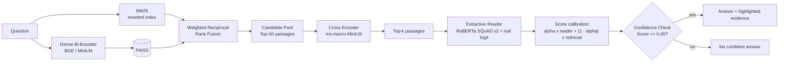

# Google Natural Questions: End-to-End Question Answering

[](https://github.com/anhvinh205/End-to-end-question-answer/actions/workflows/ci.yml)


[](https://github.com/astral-sh/ruff)

Open-domain question answering over the Wikipedia passages of Google's
[Natural Questions](https://ai.google.com/research/NaturalQuestions). A weighted hybrid retriever (BM25 and dense
vectors in FAISS, fused with Weighted Reciprocal Rank Fusion) and an optional Cross-Encoder Re-ranker find candidate
passages, and an extractive Transformer reader (RoBERTa / DeBERTa) marks the exact answer span inside them, or abstains
when no passage contains one.

The repository covers the whole loop: data cleaning and auditing, indexing, reader fine-tuning,
evaluation, a REST API, an evidence-first Streamlit demo, Docker, CI, and a test suite.



## What is in here

* **Data pipeline with an audit trail.** The NQ CSV is turned into SQuAD-style records. Answers are aligned
  at token level and mapped to exact character offsets; the 9 % of answers made of several spans are kept
  instead of dropped; every discarded row is counted in `reports/data_audit.json`. Splits are made by
  passage hash, because several questions share one Wikipedia paragraph.
* **Weighted Hybrid Retrieval.** BM25 is implemented on an inverted index (~2 ms per query), dense retrieval
  uses FAISS (`FlatIP`, `FlatL2`, `IVFFlat`), and Weighted RRF prioritizes high-accuracy dense semantics without losing rare keyword hits.
* **Cross-Encoder Re-ranking.** Re-ranks the top-50 candidate pool with full cross-attention (`ms-marco-MiniLM-L-6-v2`), eliminating keyword-only distractors before the reader sees them.
* **A reader that can say "not here".** Extractive RoBERTa / DeBERTa trained on SQuAD v2 labels unanswerable examples as `[CLS]`. Natural and BM25 hard negatives are mixed into training, and the abstention threshold is tuned on validation data.
* **Calibrated final score.** Retriever and Cross-Encoder scores are calibrated via logistic margin curves before blending with reader probability (35% reader / 65% retriever relevance), preventing short superficial patterns in distractors from hijacking the answer.
* **Rigorous evaluation.** Exact Match (EM) and F1 evaluated on the official 7,830 NQ dev benchmark (`dev_official`).
* **Engineering hygiene.** `src/` layout with extras, FastAPI app factory with injectable pipeline,
  multi-stage non-root Docker image, CI matrix, ruff, mypy, offline test suite.

## Results

Measured on the official Google Natural Questions benchmark (`dev_official` split: 1,000 queries over a 7,429 passage corpus):

### 1. Retrieval Performance

| Mode | Recall@1 | Recall@5 | Recall@10 | Recall@20 | MRR | Answer Recall@5 | Latency (ms) |
|---|---:|---:|---:|---:|---:|---:|---:|
| **BM25** | 51.8 % | 69.1 % | 73.3 % | 77.9 % | 0.598 | 73.9 % | 3.5 ms |
| **Dense** | 64.0 % | 81.7 % | 85.7 % | 89.8 % | 0.719 | 85.5 % | 9.3 ms |
| **Weighted Hybrid** | 60.2 % | 78.3 % | 83.5 % | 88.5 % | 0.685 | 82.8 % | 9.3 ms |

### 2. Extractive Reader (RoBERTa on Gold Passages)

| Subset | Exact Match | F1-Score | Examples |
|---|---:|---:|---:|
| **All** | **82.95 %** | **85.96 %** | 2,000 |
| **Answerable** | 76.87 % | 82.65 % | 1,042 |
| **Unanswerable** | **89.56 %** | — | 958 |

* **Optimal null threshold**: `-3.3239` (F1 **86.2 %** with abstention vs **46.9 %** without abstention). Learning to abstain nearly doubled the F1 score by suppressing forced hallucinations.

### 3. End-to-End Question Answering (Question Only)

| Pipeline Retrieval Mode | Exact Match | F1-Score | Avg Latency | Top-k Passages |
|---|---:|---:|---:|---:|
| **Dense** | **54.90 %** | **60.67 %** | 167 ms | 5 |
| **Hybrid** | **52.20 %** | **57.40 %** | 150 ms | 5 |
| **BM25** | 48.70 % | 53.79 % | 153 ms | 5 |

## Data

`Natural-Questions-Base.csv` (307,373 rows) after `make data`:

| Split | Records | Answerable |
|---|---:|---:|
| train | 103,497 | 74,745 |
| validation | 5,766 | 4,135 |
| test | 5,532 | 3,995 |

* 50.5 % of the rows have no passage at all and are skipped; tables are skipped; 31,920 passages with a long
  answer but no short answer are kept as natural negatives.
* Every short answer that survived filtering was located in its passage. Plain `answer in passage` string
  matching finds only 90.2 % of them.
* **Use the Base file.** The Filtered variant has lost 18.1 % of the digit tokens of its passages and
  altered some names, which breaks every question with a numeric answer. Details and numbers in
  [`data/README.md`](data/README.md).

## Quick start

### 1. Demo in two minutes (no dataset needed)

```bash
git clone https://github.com/anhvinh205/End-to-end-question-answer.git
cd End-to-end-question-answer
python -m venv .venv && source .venv/bin/activate
pip install -e ".[all]"

make api    # http://localhost:8000/docs
make ui     # http://localhost:8501
```

The first start downloads the configured models (BGE/MiniLM bi-encoder, Cross-Encoder reranker, and RoBERTa reader). Without
`artifacts/`, both services build an in-memory index from the 286 passages of the 300-record sample in `data/sample/`, so
`git clone` followed by `make api` or `make ui` works immediately out of the box.

### 2. Full pipeline

```bash
# Prepare dataset (via Hugging Face or CSV)
make dev-official # or `make data` if using raw CSV
make index        # FAISS + BM25 over passages
make train        # fine-tune the reader and calibrate abstention threshold (GPU recommended)
make evaluate     # evaluate on official dev set -> reports/metrics.{json,md}
python scripts/ask.py "who wrote the song if i were a carpenter"
```

`make help` lists every target. All settings live in [`configs/config.yaml`](configs/config.yaml).

No local GPU? A free Google Colab or Kaggle GPU is enough for the training step:

```bash
git clone https://github.com/anhvinh205/End-to-end-question-answer.git && cd End-to-end-question-answer
pip install -q -e ".[all]"
# Follow the Colab workflow: prepare data, index, train, and evaluate!
make dev-official index train evaluate
```

### 3. Docker

```bash
docker compose up --build   # API on :8000, UI on :8501 (the UI calls the API)
```

## API

```bash
curl -s localhost:8000/api/v1/qa -H 'Content-Type: application/json' \
     -d '{"question": "who invented the world wide web", "top_k": 5, "mode": "hybrid"}'
```

| Endpoint | Purpose |
|---|---|
| `POST /api/v1/qa` | Answer from the knowledge base. `mode`: `bm25`, `dense` or `hybrid` (default from the config). |
| `POST /api/v1/qa/documents` | Answer over text sent in the request (PDF pages, notes). Uses a throw-away index; the shared knowledge base is untouched. |
| `GET /health` | Readiness, retrieval modes, number of indexed passages, reader checkpoint, whether abstention is on. |

The response contains `answerable`, `best_answer`, `best_context`, timings (`retrieval_ms`, `reader_ms`) and a list of
`candidates`, each with its passage, answer, character span (`start`, `end`), `reader_score`, normalised
`retriever_score`, `combined_score` and `answerable` flag. Interactive docs are served at `/docs`.

## How it works

Short version; the reasoning behind each choice is in [`docs/DESIGN.md`](docs/DESIGN.md).

1. **Retrieve.** BM25 and the bi-encoder each return their top 50; RRF (`sum 1 / (60 + rank)`) merges them.
2. **Read.** The reader scores all k passages in one batch, with a sliding window for long passages, and picks the
   best span from the 20 best start and end candidates.
3. **Decide.** `null_diff = min over windows (start[CLS] + end[CLS]) - best span logit`; the reader abstains when
   it exceeds the tuned threshold.
4. **Rank.** `S = alpha * P_reader + (1 - alpha) * S_retriever` (with `alpha = 0.35`, giving 65% weight to retriever / cross-encoder relevance), preventing clean short distractor sentences from overtaking true topical passages; passages the reader would answer rank ahead of abstentions.

The same decoding function serves the API, training-time validation and `scripts/evaluate.py`, so reported
metrics describe what is actually served.

## Repository layout

```
app/streamlit_app.py       evidence-first demo (talks to the API, or loads the models itself)
configs/config.yaml        data, retrieval, reader and evaluation settings
data/                      dataset notes and the 300-record demo sample (raw and processed data are git-ignored)
docs/DESIGN.md             design decisions and evaluation protocol
reports/                   data_audit.json, metrics.{json,md}, bm25_scaling.json
scripts/                   prepare_data, build_index, train_reader, evaluate, bm25_scaling, ask
src/nq_qa/
  data/                    text.py (detokenise with offsets), nq_csv.py (parse, align, audit, split),
                           nq_processor.py (sliding-window labels), negatives.py, corpus.py
  models/                  bm25.py, retriever.py (encoder, index, RRF), reader.py (decoding), training.py
  evaluation/              metrics.py (pure Python EM/F1/recall), harness.py, report.py
  pipeline/                e2e_qa.py (orchestration, calibration), factory.py (build from config)
  api/main.py              FastAPI application factory
tests/                     206 offline tests
Dockerfile, docker-compose.yml, Makefile, pyproject.toml, .github/workflows/ci.yml
```

## Quality

* **206 tests, 98 % line and branch coverage, no network, no GPU.** A WordPiece tokenizer is trained on the fly
  and tiny random BERTs exercise the same code as DistilBERT and MiniLM. One test fine-tunes a 2-layer model and
  checks that the decoder recovers the labelled spans, which verifies labels, training loop and decoding
  against each other. Another runs `prepare_data -> build_index -> train_reader -> evaluate -> ask` as real
  subprocesses, and the Streamlit app is driven headlessly.
* `ruff` and `mypy` are clean. The suite passes with `transformers` 4.46.3 and 5.22.1 (the supported range is
  `>=4.46,<6`), on Python 3.12 locally; CI runs 3.10, 3.11 and 3.12.
* `make check` runs lint, type check and tests, the same as CI.

## Limitations and next steps

* The dense, hybrid and reader numbers still have to be produced on a machine with GPU and Hub access (see Results).
* Evaluation uses a closed corpus and one reference per question; a faithful open-domain protocol would
  index the Wikipedia passages and use all annotator answers.
* The reader is extractive: it cannot answer yes/no questions or combine facts from several passages.
* Next: a cross-encoder re-ranker on the top 20, fine-tuning the bi-encoder on NQ pairs with hard negatives,
  ONNX / int8 export to cut CPU latency, and a Vietnamese variant of the pipeline.

## References

Kwiatkowski et al., *Natural Questions: a Benchmark for Question Answering Research*, TACL 2019 ·
Karpukhin et al., *Dense Passage Retrieval for Open-Domain QA*, EMNLP 2020 ·
Cormack et al., *Reciprocal Rank Fusion outperforms Condorcet and individual rank learning methods*, SIGIR 2009 ·
Robertson and Zaragoza, *The Probabilistic Relevance Framework: BM25 and Beyond*, 2009 ·
Rajpurkar et al., *Know What You Don't Know: Unanswerable Questions for SQuAD*, ACL 2018 ·
Sanh et al., *DistilBERT*, 2019 · Reimers and Gurevych, *Sentence-BERT*, EMNLP 2019.

## Licence

Code: MIT. Natural Questions data and Wikipedia text: CC BY-SA 3.0 (see [`data/README.md`](data/README.md)).
